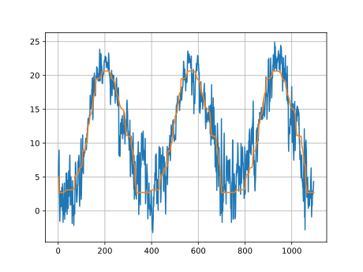
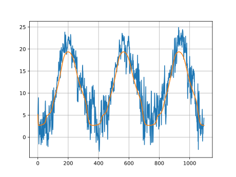
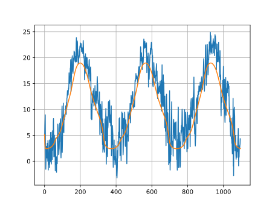

# 🌦️ Poggio Rusco Temperature Predictor (`PoggioRuscoTemps`)

A PyTorch-based machine learning project designed to predict localized daily 2m temperatures ($t_{2m}$) in **Poggio Rusco** (Latitude: 44, Longitude: 11) using historical weather records and continuous cyclical date encodings.

---

## 🏗️ Project Architecture & Pipeline

The pipeline is split into two primary components: a robust data preprocessing script and a deep feed-forward neural network.

### 1. Data Preprocessing (`PreProcessData.py`)
* **Filtering & Cleaning:** Extracts and filters global weather records for the specific spatial coordinates of Poggio Rusco ($Lat=44, Lon=11$).
* **Temperature Unit Conversion:** Converts raw temperature data from Kelvin to Celsius ($\text{Celsius} = \text{Kelvin} - 273$).
* **Cyclical Date Encoding:** Maps calendar dates into continuous 2D coordinates using trigonometric sine and cosine functions to accurately preserve seasonal circularity:
  $$\text{xDate} = \cos(2\pi p), \quad \text{yDate} = \sin(2\pi p)$$
  where $p$ represents the fraction of the year elapsed.
* **Temporal Data Split:** 
  * **Train Set:** Years 2014–2021 (~2,921 samples)
  * **Test Set:** Years 2022–2024 (~1,095 samples)

---

### 2. Neural Network Model (`StdNet`)
Implemented in **PyTorch**, `StdNet` is a fully connected feed-forward neural network built to predict the next day's temperature ($t_{2m\text{\_next}}$) based on temporal coordinates and the current temperature.

* **Input Features ($3$):** `xDate`, `yDate`, `t2m_now`
* **Hidden Layers:** Three dense hidden layers with **512 units each**, utilizing `Sigmoid` activation functions.
* **Output Layer ($1$):** Single regression output predicting `t2m_next`.

```python
import torch
import torch.nn as nn

class StdNet(nn.Module):
    def __init__(self):
        super().__init__()
        self.lay1 = nn.Linear(3, 512)
        self.lay2 = nn.Linear(512, 512)
        self.lay3 = nn.Linear(512, 512)
        self.lay4 = nn.Linear(512, 1)

    def forward(self, x):
        x = torch.sigmoid(self.lay1(x))
        x = torch.sigmoid(self.lay2(x))
        x = torch.sigmoid(self.lay3(x))
        x = self.lay4(x)
        return x[:, 0]

```

### 3. 📊 Results & Autoregressive Simulation

The model is optimized using Mean Squared Error (MSE) loss and the Adam optimizer ($\text{lr} = 0.001$). Beyond single-step evaluation, the repository includes an iterative/autoregressive evaluation loop (TryModelsOut.py), where the model's prediction dynamically feeds back as the next step's input to test long-term trajectory tracking.

### 4. Actual vs. Iterative Predicted Temperature Plot

## 📊 Results & Autoregressive Simulation

To evaluate how training dynamics scale, `StdNet` was trained across **six different batch sizes** ($32, 64, 128, 256, 512, 1024$). The resulting model weights are stored in the `./NetParams` directory following this naming convention:

```text
KiNetV1_{BatchingSize}.pth
```

The plots below compare the autoregressive iterative predictions (in orange) against the actual ground-truth test set temperatures (in blue) for each trained batch size:

## Batch Size = 32



## Batch Size = 64


## Batch Size = 128


## Batch Size = 256


## Batch Size = 512



## Batch Size = 1024




